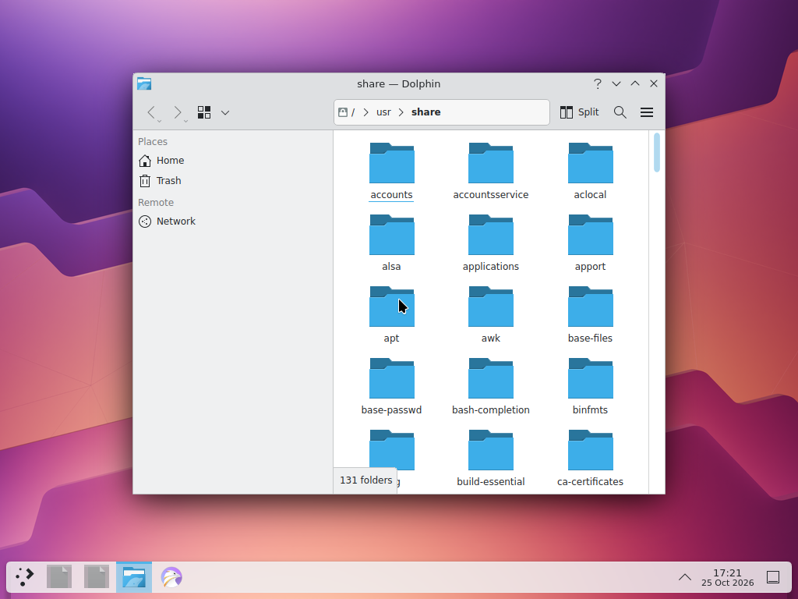
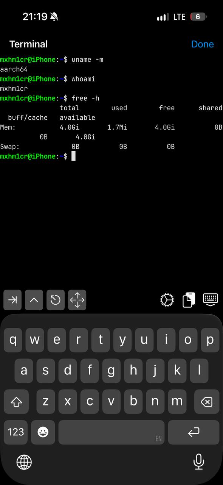
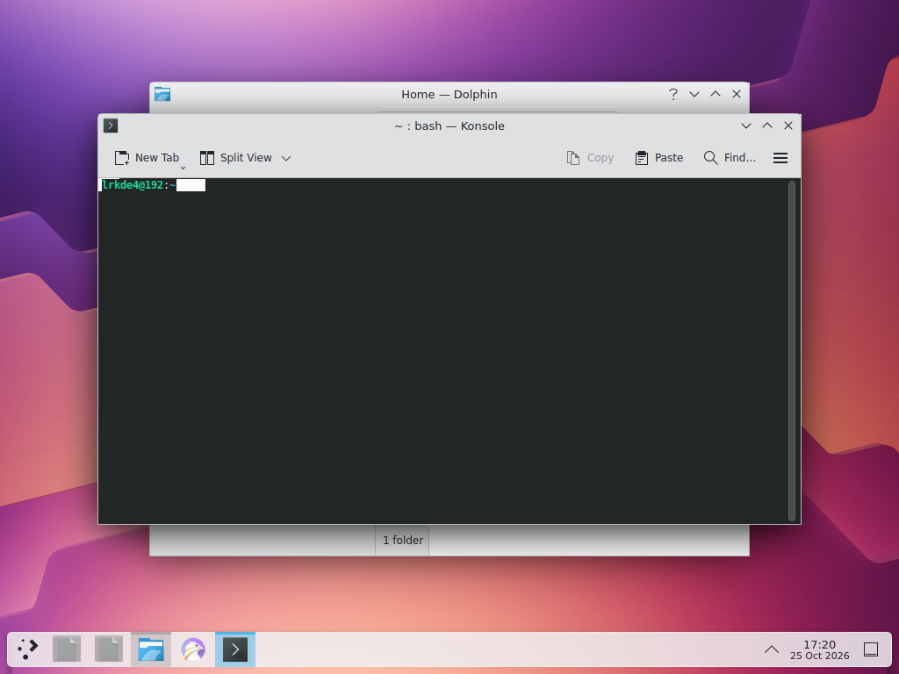
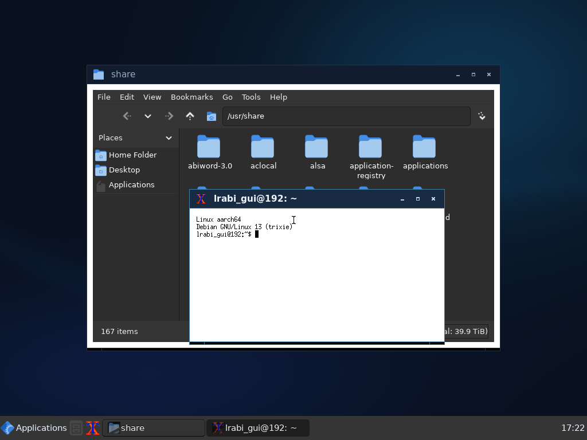
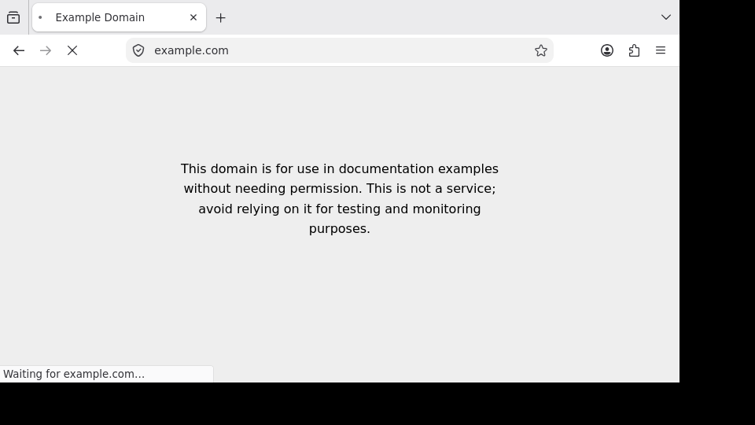

# LinuxRunner

### Linux on your iPhone.

Run ARM64 Linux userspace applications and desktop environments on iOS, powered by a custom ARM64 interpreter and Linux compatibility layer.

**No jailbreak. No virtual machine. No JIT.**

**KDE Plasma**

## What LinuxRunner can do

- **Choose your Linux environment.** Install Debian ARM64 or use bundled Alpine ARM64, with a shell, Linux user accounts and package managers such as `apt` and `apk`.
- **Open a Linux desktop.** Use LinuxRunner Desktop or explore KDE Plasma, with windows, a panel and a file manager.
- **Run Linux applications.** Work with Dolphin and Konsole, browse with Firefox or Chromium, and explore Blender. Compatibility varies by application, version and workload.
- **Use familiar development tools.** Install compilers, Python, Node.js and other available ARM64 Linux packages.
- **Explore Linux graphics.** Mesa provides software rendering; experimental Metal acceleration supports selected OpenGL rendering paths.

KDE Plasma and Metal acceleration are experimental. Browsers, Blender and other demanding applications have compatibility and memory limits.

## Screenshots

<table>
  <tr>
    <td align="center"> <b>LinuxRunner</b></td>
    <td align="center"> <b>Linux Terminal</b></td>
    <td align="center"> <b>Settings</b></td>
  </tr>
</table>

<table>
  <tr>
    <td align="center"> <b>KDE Plasma</b></td>
    <td align="center"> <b>LinuxRunner Desktop</b></td>
  </tr>
  <tr>
    <td align="center"> <b>Firefox</b></td>
    <td align="center"> <b>Blender</b></td>
  </tr>
</table>

## Installation

1. Download the latest LinuxRunner IPA from [GitHub Releases](https://github.com/mxhm11cr/LinuxRunner/releases/latest).
2. Install the IPA using your preferred compatible sideloading tool, such as [Sideloadly](https://sideloadly.io/) or [AltStore Classic](https://altstore.io/).
3. Open LinuxRunner on your iPhone.
4. Follow the in-app setup instructions to install a Linux environment.

The IPA is unsigned; your sideloading tool must sign it. Signing requirements, app refresh periods and compatibility depend on the tool and account you use. No particular sideloading service is guaranteed to work.

App Group access is optional: LinuxRunner uses private app storage when it is unavailable. When updating, keep the bundle identifier and App Group settings consistent so existing environments remain accessible. Back up important files before changing signing settings.

## Getting started

Choose **Debian ARM64** for desktop applications, or **Alpine ARM64** for a smaller terminal environment. Complete the environment setup, reopen LinuxRunner when prompted, and create your Linux account.

For a graphical session, select **Install Desktop Components**, then **Open Desktop**. KDE Plasma is available through the desktop controls. Keep LinuxRunner open while installing packages; use the Terminal whenever you need a shell.

## How it works

LinuxRunner interprets ARM64 Linux instructions and implements the Linux system calls that applications need. It runs Linux userspace inside the iOS application rather than booting an unmodified Linux kernel. It does not use QEMU.

X11 applications draw to an Xvfb display, which the app presents through its desktop viewer. Mesa handles software OpenGL; an optional Metal bridge accelerates supported rendering operations. This graphics path is experimental and does not provide full OpenGL compatibility.

## Compatibility and limitations

- **Linux environments:** Debian 13 and Alpine 3.24, ARM64. x86 and x86-64 applications are not supported.
- **iOS:** deployment target 15.0 or later. Available memory, storage and the iOS version affect which workloads are practical.
- **Applications:** package availability does not guarantee full compatibility. Browsers and Blender may encounter unsupported features, slow operations or crashes.
- **Desktops and graphics:** KDE Plasma and Metal acceleration are experimental. Large workloads may exceed the memory available to the app.
- **Foreground operation:** iOS can suspend LinuxRunner in the background. Keep Screen Awake prevents the foreground idle lock, not background suspension.
- **Linux features:** kernel modules, systemd as init, containers and Wayland sessions are not supported. Direct hardware access is limited by iOS.
- **Security:** Linux users and permissions do not isolate hostile programs from the app. See [SECURITY.md](SECURITY.md).

## Building from source

Developers need Xcode with the iOS SDK, Python 3, Meson, Ninja and CMake. Build the **LinuxRunner** scheme in `iSH.xcodeproj`.

The [build guide](docs/BUILDING.md) covers cloning the repository, initializing the pinned dependencies and producing an unsigned IPA. Building from source is optional; ordinary installation uses the downloadable IPA.

## Credits and license

Maintained by **Leminos ([@mxhm11cr](https://github.com/mxhm11cr))**. LinuxRunner builds on [iSH](https://github.com/ish-app/ish), by Theodore Dubois and contributors, through [ios-linuxkit](https://github.com/rcarmo/ios-linuxkit), by Rui Carmo and contributors.

The combined application is GPL-3.0-covered, with the upstream contribution-specific terms and App Store exception preserved in [LICENSE.md](LICENSE.md) and [LICENSE.IOS](LICENSE.IOS). Third-party components keep their own licenses; see [THIRD_PARTY_NOTICES.md](THIRD_PARTY_NOTICES.md). LinuxRunner is an independent downstream project.
