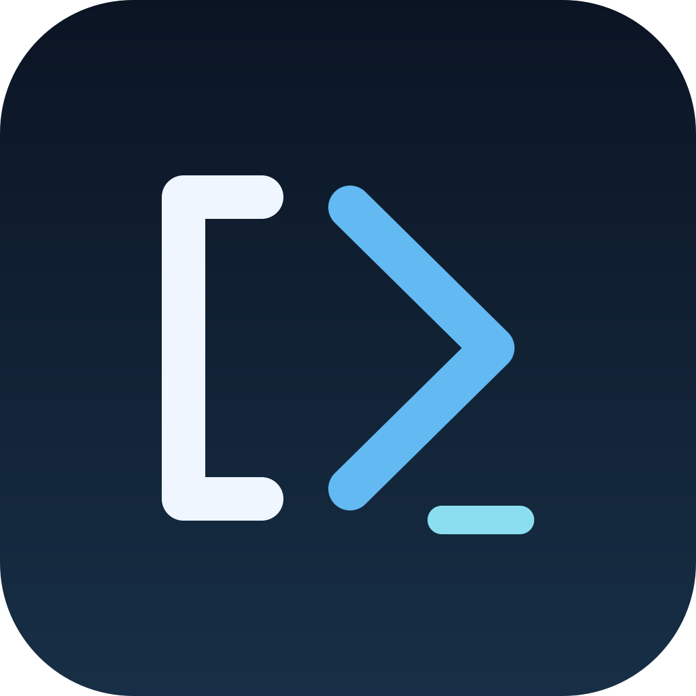
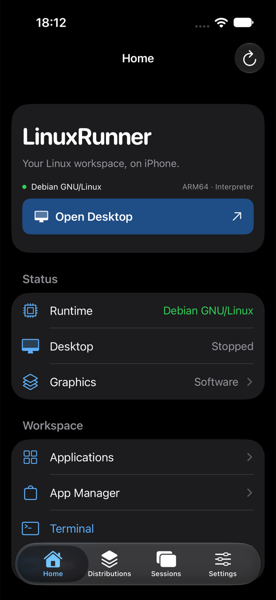
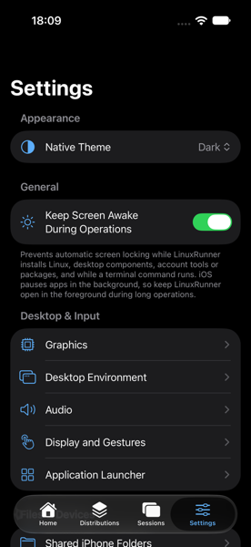
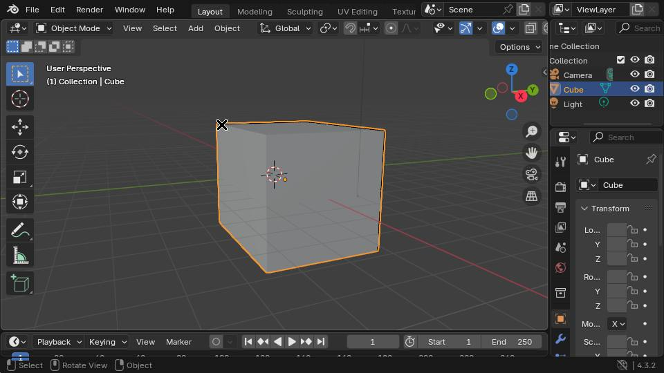
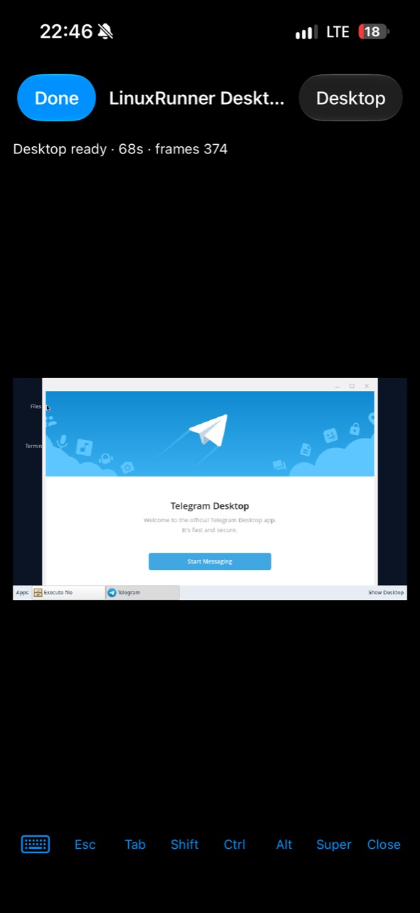

  

<h1 align="center">LinuxRunner</h1>
<h3 align="center">Linux on your iPhone and iPad.</h3>

ARM64 Linux userspace, terminals and desktop applications on iOS and iPadOS.

  
  
  

LinuxRunner uses a custom ARM64 interpreter and Linux compatibility layer to load Linux programs, implement their system calls and connect them to storage, networking and a graphical desktop on supported devices.

**No jailbreak. No virtual machine. No JIT required by the release build.**

[Download the latest release](https://github.com/mxhm11cr/LinuxRunner/releases/latest) · [Set up Linux](docs/GETTING_STARTED.md) · [Troubleshooting](docs/TROUBLESHOOTING.md)

**KDE Plasma** — an experimental Debian desktop option.

<table>
<tr>
<td align="center"> <b>LinuxRunner</b></td>
<td align="center"> <b>Settings</b></td>
</tr>
<tr>
<td align="center"> <b>Firefox</b></td>
<td align="center"> <b>Blender</b></td>
</tr>
</table>

LinuxRunner on iPhone: KDE Plasma, Firefox, Blender and Arch Linux ARM. The Arch capture below shows Telegram Desktop. Setup and iPad screenshots will be added when supplied.

### Telegram Desktop on Arch Linux ARM

  

**Telegram Desktop** — tested on Arch Linux ARM: login, sending messages and calls. The supplied iPhone capture shows its welcome screen.

## Highlights

- **Three Linux distributions:** Debian GNU/Linux ARM64, Arch Linux ARM and Alpine Linux ARM64, each with its own packages and files.
- **A Linux terminal:** shells, standard user accounts, package managers and available ARM64 command-line tools.
- **Linux desktops and applications:** an X11 desktop with windows, a panel and file management; experimental KDE Plasma on Debian.
- **Touch, keyboard and pointer input:** on-screen controls, hardware keyboard forwarding and supported mouse/trackpad events.
- **Files and networking:** import/export, optional shared folders and Linux sockets over the device's network, subject to iOS restrictions.
- **New in 1.0.1:** iPad desktop adaptations, unified distribution setup, Arch package recovery and desktop/session improvements. [Changelog](CHANGELOG.md)

## Supported Devices

| Device | Configuration | Qualification |
| --- | --- | --- |
| iPhone | ARM64; iOS 15.0 deployment target; portrait and both landscape orientations | The maintainer reports build 897 running Arch, its graphical desktop and graphical applications on a physical iPhone. |
| iPad | ARM64; iPadOS 15.0 deployment target; all four orientations | iPad support is included in v1.0.1 and has been tested on a physical iPad. |

Deployment targets describe the build configuration, not a guarantee for every device or OS version. Available memory and storage affect practical workloads. An older report of an iPhone 11/iOS 17 launch black screen remains unresolved.

### LinuxRunner on iPad

The larger display gives Linux windows more room. The viewer sizes a new **Fit Screen** session to the current window and provides **Fit to Screen**, **Actual Size**, touch gestures, hardware keyboard forwarding and pointer handling. Desktop actions also have Control–Option–Command shortcuts. Rotation and window size are handled by the interface; changing the Linux display resolution takes effect at the next desktop start. iPad support has been physically tested by the maintainer. [Controls and shortcuts](docs/GETTING_STARTED.md#11-launch-and-use-the-desktop)

## Supported Linux Distributions

| Distribution | Terminal | Package manager | Desktop | Status |
| --- | --- | --- | --- | --- |
| Debian GNU/Linux 13 ARM64 | Supported | `apt` / `dpkg` | LinuxRunner Desktop; KDE Plasma experimental | Recommended starting point |
| Arch Linux ARM | Supported | `pacman` | Openbox with LXQt Panel and PCManFM-Qt | Experimental; maintainer reports desktop success on iPhone build 897 |
| Alpine Linux 3.24 ARM64 | Supported | `apk` | Desktop path exists; compatibility remains experimental | Best suited to a smaller terminal environment |

Arch uses selected LXQt components, not a claim of a complete LXQt session. Current Arch Plasma and Wayland sessions are unavailable. Multiple environments can coexist; one runtime is active per app launch.

## Installation

1. Download the LinuxRunner IPA from [GitHub Releases](https://github.com/mxhm11cr/LinuxRunner/releases/latest).
2. Install it with your preferred compatible IPA sideloading tool, such as [Sideloadly](https://sideloadly.io/) or [AltStore Classic](https://altstore.io/).
3. Open LinuxRunner on your iPhone or iPad.
4. Follow **Set Up Linux…** to install a distribution inside the app.

Signing and compatibility depend on the selected method. The v1.0.1 packaging script produces an ad-hoc-signed IPA without an Apple provisioning profile; a compatible tool must provide the signing/provisioning needed for installation. Keep the same app identity and storage configuration when updating. [Download verification and signing](docs/INSTALLATION.md)

## Getting Started — Installing Linux in LinuxRunner

Installing the IPA installs the application. **You then install or configure a Linux distribution inside it.**

Open **Distributions → Set Up Linux… → Continue**. Choose Debian, Arch or Alpine, then continue to that distribution's install button. Follow the requested app relaunch, create or select a Linux account and install desktop components if wanted. Use **Home → Terminal** for a shell, or **Open Desktop** / **Resume Desktop** for a graphical session.

The [step-by-step guide](docs/GETTING_STARTED.md) covers existing environments, account options, progress, terminal commands, package installation and desktop controls. It uses the labels in the current app.

## Desktop Environments and Applications

LinuxRunner Desktop is the default lightweight X11 session. On Debian, KDE Plasma can be installed later through **Settings → Desktop Environment**. On Arch, use the Openbox/LXQt-component desktop offered by setup.

Install software through **Home → App Manager** or the distribution's package manager. Start discovered graphical applications through **Home → Applications**. Use a regular Linux user for everyday work; `sudo` is available to accounts created with administrator privileges.

**Telegram Desktop has been tested on Arch Linux ARM with build 897, including login, sending messages and calls.** Earlier supplied captures also show Dolphin, Firefox and Blender. [Application compatibility](docs/COMPATIBILITY.md)

## How LinuxRunner Works

The executable loader maps ARM64 Linux ELF programs and their libraries. The interpreter executes supported guest instructions through precompiled host routines. A userspace compatibility layer implements Linux system calls, processes, threads, signals, memory mappings and filesystem metadata. Linux sockets connect through the platform network APIs.

Graphical applications use X11: Xvfb and x11vnc feed the native desktop viewer, which forwards display updates and input. Mesa supplies software OpenGL; an experimental Metal bridge accelerates selected rendering paths. This is userspace compatibility with instruction interpretation, rather than full-system emulation or hardware virtualization. LinuxRunner does not boot a Linux kernel or execute arbitrary guest code natively. [Architecture](docs/ARCHITECTURE.md)

## Compatibility and Limitations

- ARM64 Linux programs only; x86/x86-64 applications and Linux kernel boot are unsupported.
- System-call and graphics coverage is incomplete. Package availability does not establish application compatibility.
- Arch desktop, Debian KDE Plasma and Metal acceleration are experimental; demanding programs may be slow or exceed device memory limits.
- No Wayland session, systemd as init, kernel modules or conventional Linux containers.
- iOS/iPadOS can suspend or terminate the app. **Done** retains a running desktop within the app; termination does not preserve running Linux processes.
- Linux accounts and permissions do not isolate hostile software from the application. The platform sandbox is the security boundary.

See [compatibility](docs/COMPATIBILITY.md), [known limitations](docs/KNOWN_LIMITATIONS.md) and the [security policy](SECURITY.md).

## Troubleshooting and Bug Reports

Start with [Troubleshooting](docs/TROUBLESHOOTING.md). The App Manager's **Repair Center** provides diagnosis and package repair; **Settings → Advanced → Export Open Desktop Report** collects startup/session information. Review reports for personal data before sharing.

[Report a reproducible issue](https://github.com/mxhm11cr/LinuxRunner/issues/new/choose) with your device, OS, app version/build, distribution and steps. A launch report is useful even when an application is not fully compatible.

## Building and Contributing

Most users install the IPA. Developers can build the **LinuxRunner** scheme in `iSH.xcodeproj`; see the [build guide](docs/BUILDING.md) for tool requirements, pinned dependencies and verification. [Contributing](CONTRIBUTING.md) covers focused changes and useful compatibility reports.

## License and Acknowledgments

Maintained by **Leminos ([mxhm11cr](https://github.com/mxhm11cr))**. LinuxRunner derives from [iSH](https://github.com/ish-app/ish), by Theodore Dubois and contributors, through [ios-linuxkit](https://github.com/rcarmo/ios-linuxkit), by Rui Carmo and contributors.

The combined application is GPL-3.0-covered. Preserve upstream contribution-specific terms, copyright attribution and the App Store terms in [LICENSE.md](LICENSE.md) and [LICENSE.IOS](LICENSE.IOS). Third-party software retains its own licenses; see [THIRD_PARTY_NOTICES.md](THIRD_PARTY_NOTICES.md). Linux distributions, desktops and applications are the work of their respective projects.
